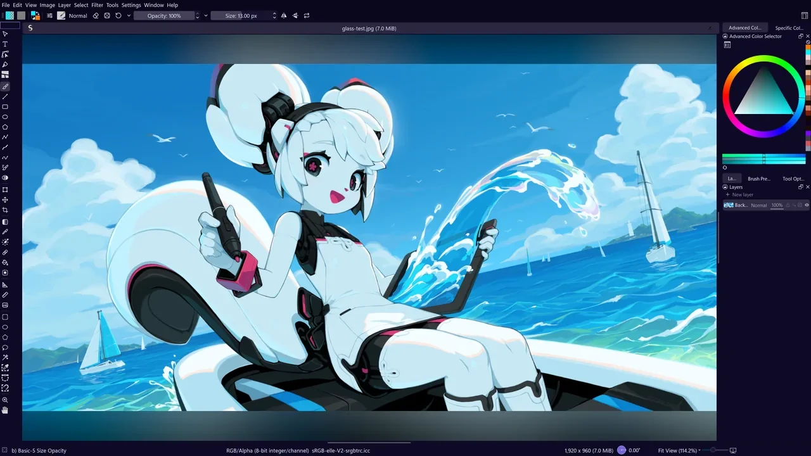

# Skissa

Krita with a cleaner, more visual interface. Same brushes, same engine, same `.kra` files.

I paint in Krita every day and wanted it to feel more like the tablet apps: the canvas gets the screen, and everything else shows up when you need it.

## Ctrl+K finds anything

Tools, brushes, effects, settings and every old menu command. Effects preview live on the canvas.

## Drag brush settings

## Blend modes you can see

## Symmetry

## Themes

## Get it

**Windows:** download the zip from [Releases](../../releases), unzip it and run `bin\krita.exe`.

**Build it:** same as Krita, using [Krita's build guide](https://docs.krita.org/en/untranslatable_pages/building_krita.html) with this repo.

It keeps its own settings and brushes, so a regular Krita on the same computer stays exactly as it is. To bring your Krita settings over: Settings, then ⋯, then Take Krita's settings. The classic layout is a Ctrl+K away: Studio Layout.

---

An independent fork of [Krita](https://krita.org), modified by GeorgeAzma since 2026. Not affiliated with or endorsed by the Krita Foundation or KDE; Krita is a trademark of the Stichting Krita Foundation. GPL-3.0-or-later, like Krita. Screenshot art: "Kiki Paints Over the Waves" by Tyson Tan, Krita's splash, [CC BY-SA 4.0](https://tysontan.com/gallery/gallery-mascots/kiki-splash-2026/). See [NOTICE](NOTICE).
