<picture>
  <source media="(prefers-color-scheme: dark)" srcset="docs/readme/icon-dark.png">
  
</picture>

# Skissa
Fork of Krita, with a redesigned UI targeting intuition.

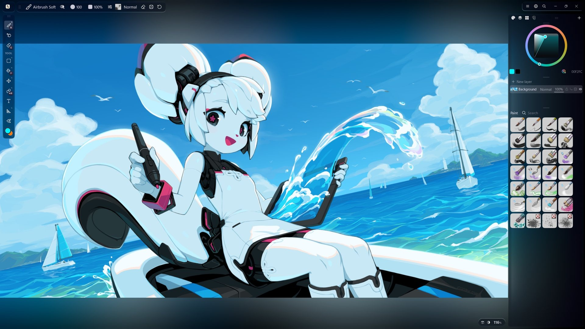

<table>
<tr>
<td width="50%">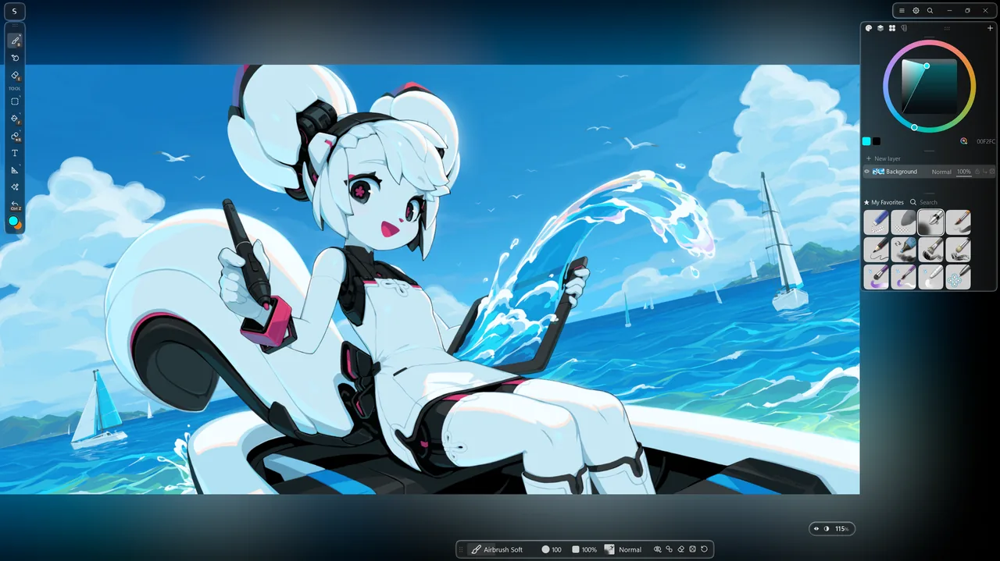 <b>Put anything anywhere</b></td>
<td width="50%"> <b>Effects on the image</b></td>
</tr>
<tr>
<td>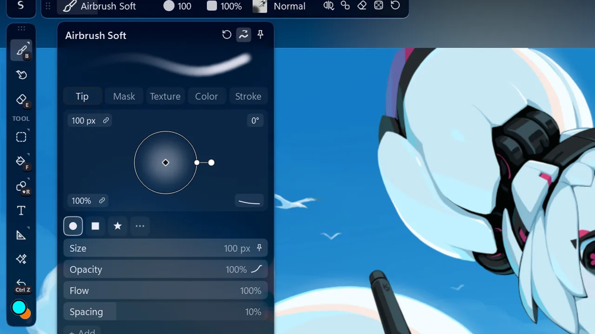 <b>Drag any value</b></td>
<td>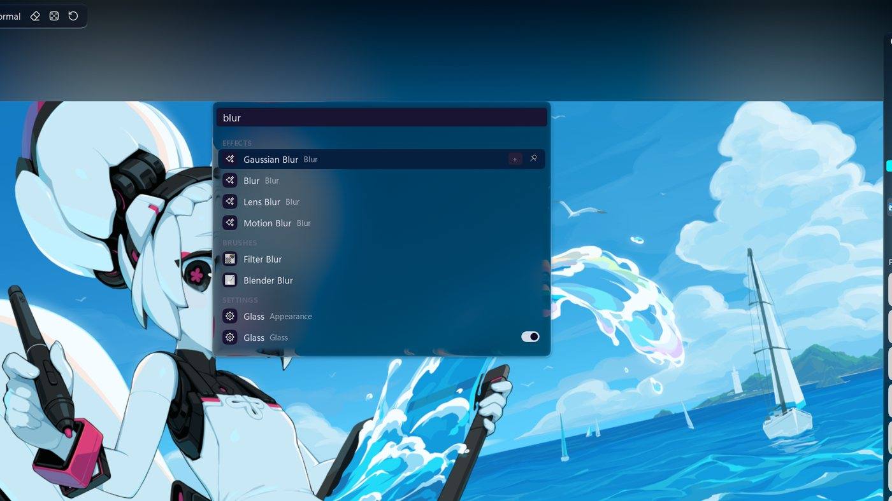 <b>Ctrl+K</b></td>
</tr>
<tr>
<td>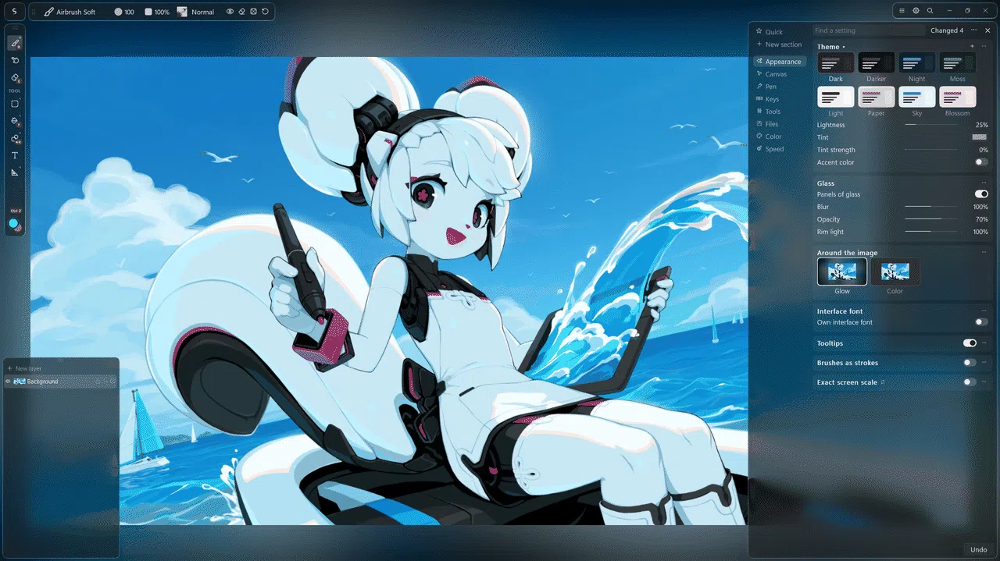 <b>Themes and glass</b></td>
<td>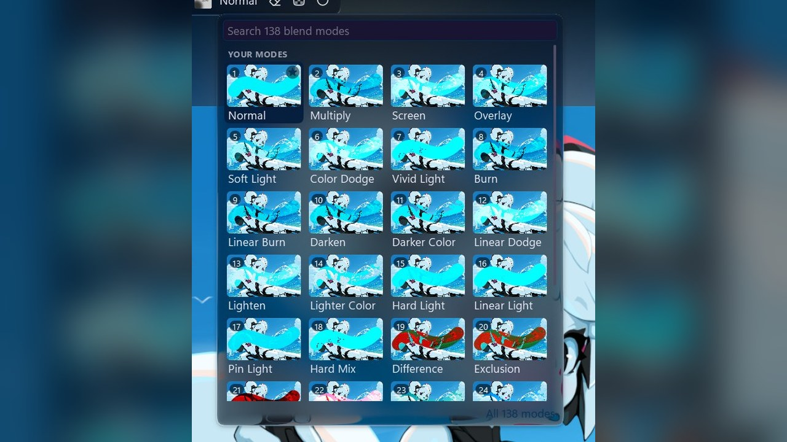 <b>Blend modes you can see</b></td>
</tr>
<tr>
<td>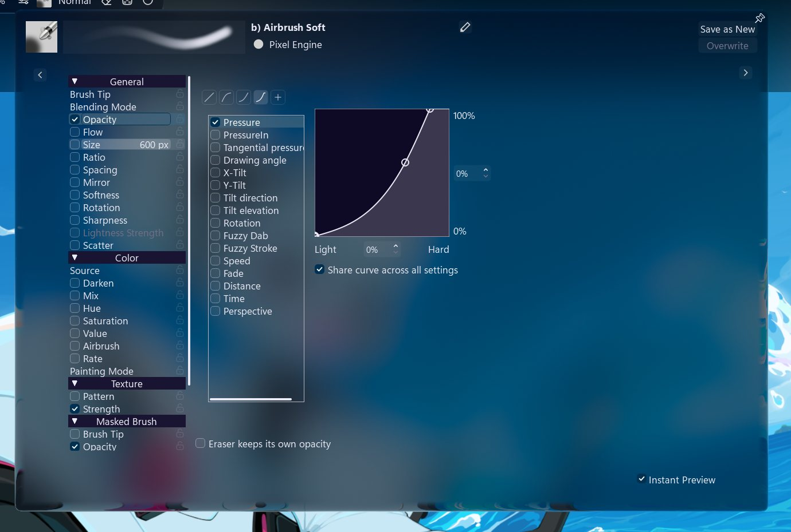 <b>Brushes</b></td>
<td>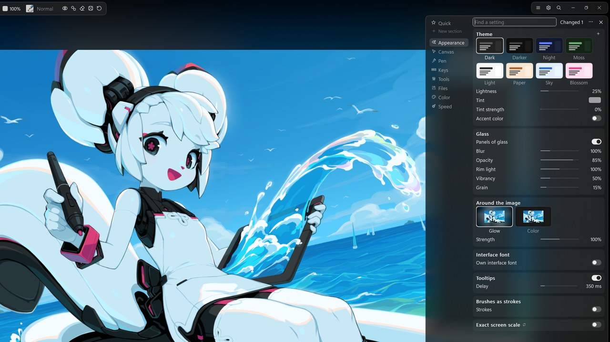 <b>Settings</b></td>
</tr>
<tr>
<td>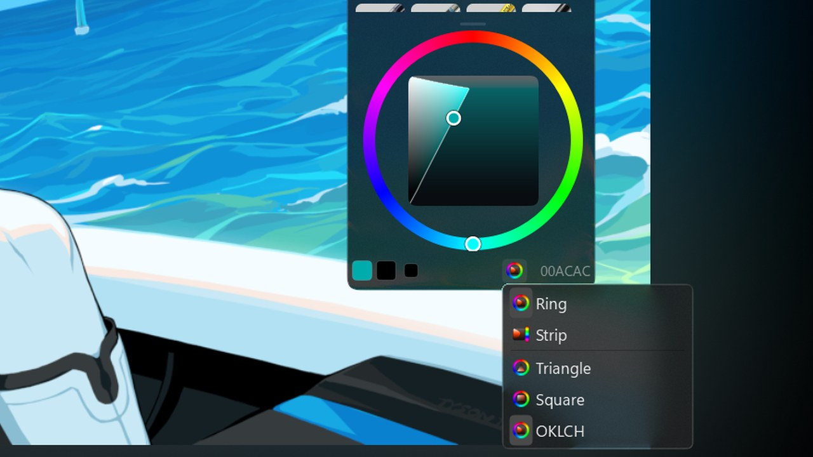 <b>Color</b></td>
<td>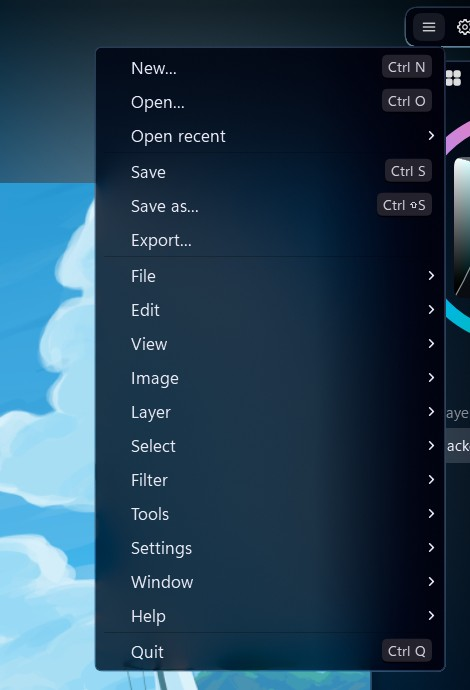 <b>Every Krita menu</b></td>
</tr>
<tr>
<td>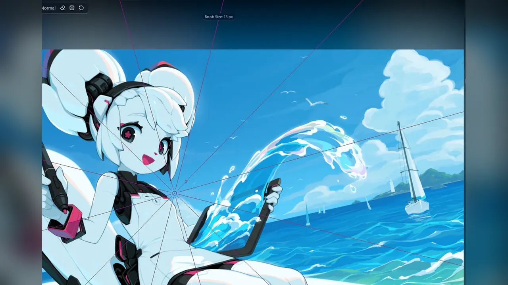 <b>Symmetry</b></td>
<td>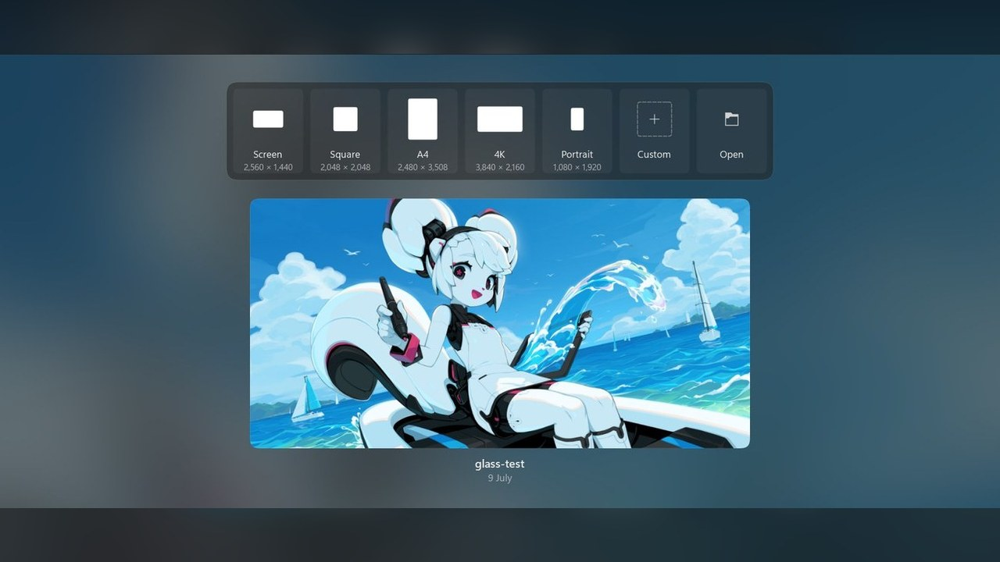 <b>Start page</b></td>
</tr>
<tr>
<td>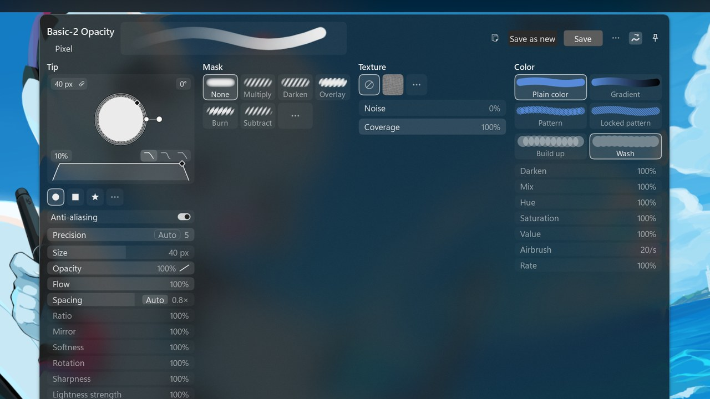 <b>A whole brush on one sheet</b></td>
<td>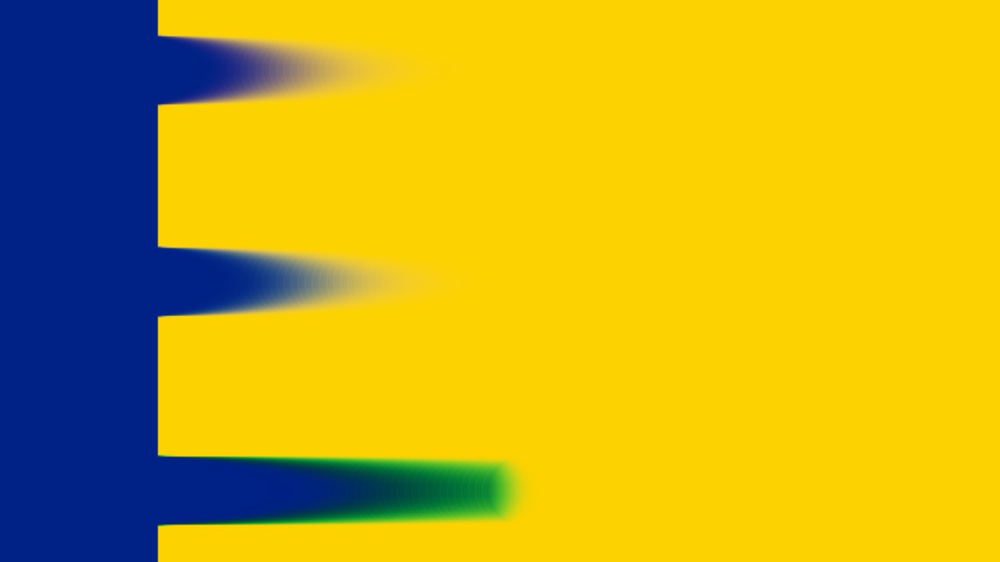 <b>Paint that mixes like paint</b></td>
</tr>
<tr>
<td>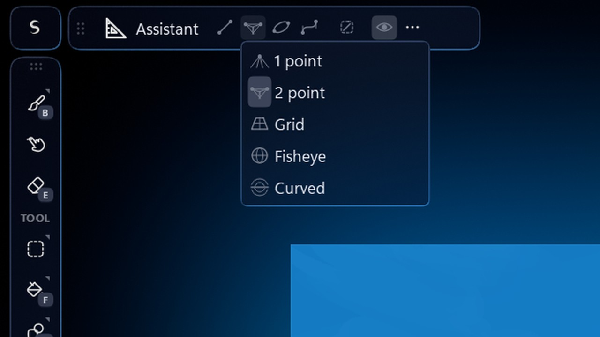 <b>Guides</b></td>
<td>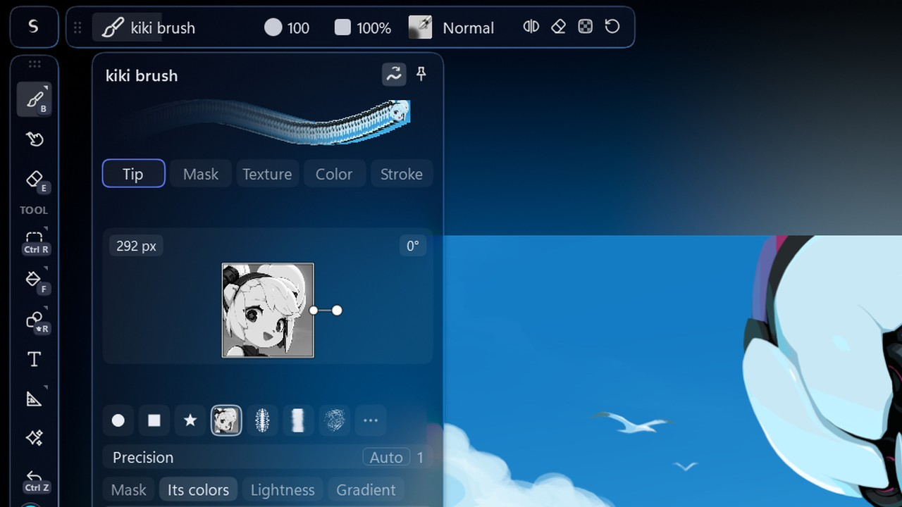 <b>A brush from any selection</b></td>
</tr>
</table>

The code was written by an LLM, on top of Krita's code. All the UI designs were done manually.

[Support Krita](https://krita.org/support-us/donations)

### [Install](../../releases)
- unzip
- launch `bin\krita.exe`

> [!NOTE]
> Skissa uses separate settings files from Krita, so your Krita settings stay unchanged and can be imported into Skissa.

### Philosophy Behind It
I've always wondered why the UI of so much software is so cluttered, for example you know those menu bars, where you have a bunch of different items like: `File`, `Edit`, `View`, `Help`... and to actually find what you want you have to go through them; like why? clearly if someone were to make an ideal UI, you would not need to search for anything, it would all intuitively be available in front of you; so I made Skissa to demonstrate my ideas of what an intuitive UI might look like, I have reworked the UI from scratch, based on first principles, meaning forgetting everything about previous conceptions of how UI is done and designing from fundamentals, like the way human perception works, what purpose people have when they open the canvas, how frequent certain actions are, so that we can minimize the amount of effort needed for using them, whilst keeping the screen as clear as possible so that the canvas is the center of attention. I've made every UI customizable to accommodate different styles, you can drag almost any command onto the top bar to add it as a button. This is not supposed to be a product or anything, it is a demonstration of ideas for intuitive UI design, in hopes that maybe someone might get inspired by some UI design choices, or give feedback.

---

An independent fork of [Krita](https://krita.org), modified by GeorgeAzma since 2026. Not affiliated with or endorsed by the Krita Foundation or KDE; Krita is a trademark of the Stichting Krita Foundation. GPL-3.0-or-later, like Krita. Screenshot art: "Kiki Paints Over the Waves" by Tyson Tan, Krita's splash, [CC BY-SA 4.0](https://tysontan.com/gallery/gallery-mascots/kiki-splash-2026/). See [NOTICE](NOTICE).
