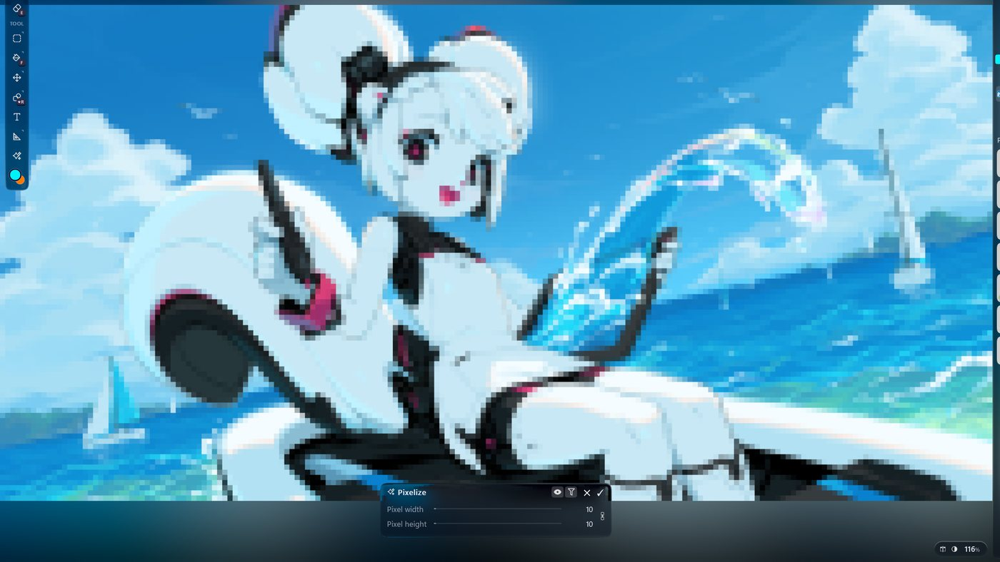
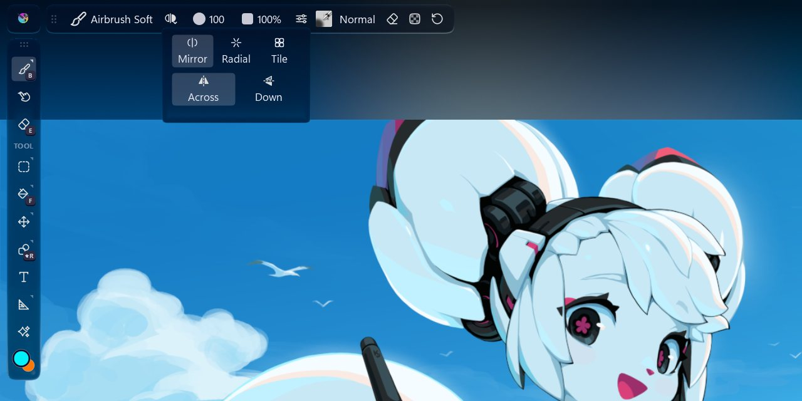
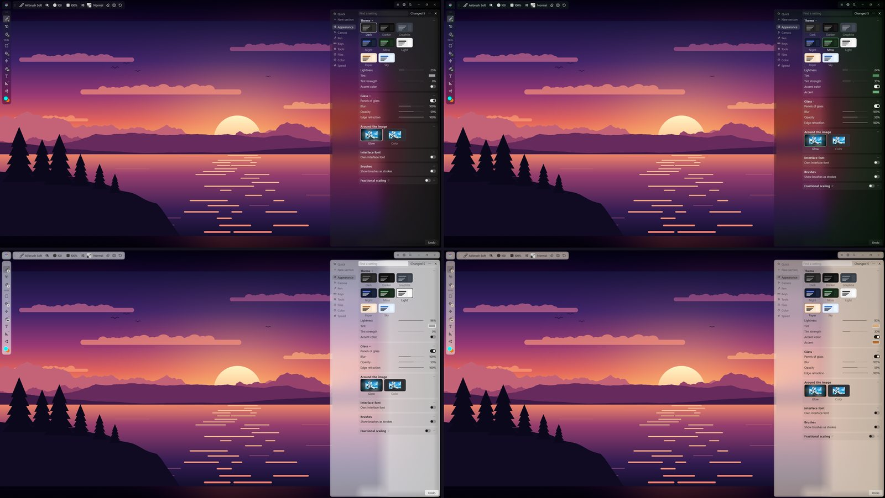

# Krita Studio

A calmer, more visual Krita. Same brushes, same files and the same paint engine underneath, with a lot less hunting through menus and dialogs.

This is a personal fork of [Krita](https://krita.org). I paint in Krita every day and wanted it to feel as easy as the tablet apps without losing anything that makes Krita great. So the interface was rebuilt around one idea: **the canvas comes first, and everything else shows up when you need it.**

## What feels different

### The canvas gets the screen

Tools on the left, panels on the right, and the top bar only shows what the current tool needs. There's no menu bar, status bar or scroll bars. Panels slide out over the edge of the canvas and get out of the way again.

Krita's 37 tools fit into 9 slots grouped by what you want to do: **Paint, Blend, Erase, Select, Move, Fill, Shape, Text, Guides.** Each slot remembers the variant you used last.

### Find anything

Press **Ctrl+K** and type. Tools, effects, brushes, blend modes, layers, settings and every old menu command are all in one place. It speaks other apps' language too: "lasso", "magic wand", "eyedropper" or "healing brush" find the Krita version.

### Effects right on the canvas

Pick an effect and it previews live on your whole image, with its sliders in a small panel at the bottom. Enter keeps it, Esc drops it, or keep it editable for later.

### Blend modes you can see

Every blend mode is a tiny preview of what it'll actually do to your picture. The everyday ones are up front, and all 138 are one search away.

### Brush settings you drag

Each setting in the brush editor shows its value on its own row: drag sideways to change it, double-click to type a number. Pressure curves come as little pictures, and you can save your own and reuse them in any brush.

### Symmetry in one button

Mirror, radial or tiled. The handles sit on the canvas, so you drag the center where you want it instead of typing numbers.

### Glass, and themes that are yours

Panels are frosted glass with a bit of edge refraction, so your painting keeps showing through. Pick a theme, or mix your own from a lightness, a tint and an accent color.

### Small things that add up

- **Right-click** any slider to put it back to its default.
- Hover a button to see its shortcut; right-click it to change the shortcut.
- **Ctrl+Z** undoes settings too, in the same history as your painting.
- Autosave waits until you pause, so it never hitches mid-stroke.
- Krita opens the image you were working on last.
- All settings live in one searchable panel with short, plain tooltips.

## Old Krita vs Studio

| | Krita | Krita Studio |
|---|---|---|
| Tools on screen | 37 | 9 slots, variants inside |
| Menus | 266 commands in 11 menus | **Ctrl+K** and a small ☰ menu |
| Blend modes | a list of 138 | previews, everyday ones first |
| Effects | dialogs | live on the canvas |
| Brush settings | sliders on separate pages | values on the rows, drag to change |
| Settings | 10 dialog pages | one panel, searchable, undoable |

## It's still Krita

It opens and saves `.kra` files as usual and uses your brushes, resources and plugins. If you ever want the classic layout back, press **Ctrl+K** and turn off **Studio Layout**.

Heads-up: for now it uses the same settings folder as a regular Krita install, so the two share settings.

## Get it

**Windows:** download the latest zip from [Releases](../../releases), unzip it anywhere and run `bin\krita.exe`. There's no installer and nothing to uninstall.

**Build it yourself:** it builds exactly like Krita. Follow Krita's [build guide](https://docs.krita.org/en/untranslatable_pages/building_krita.html) with this repository.

## Credits

Built on [Krita](https://krita.org) by the KDE community and the Krita Foundation, and licensed the same way (GPL-3.0-or-later). The sunset was drawn for these screenshots; the character artwork is Krita's.
